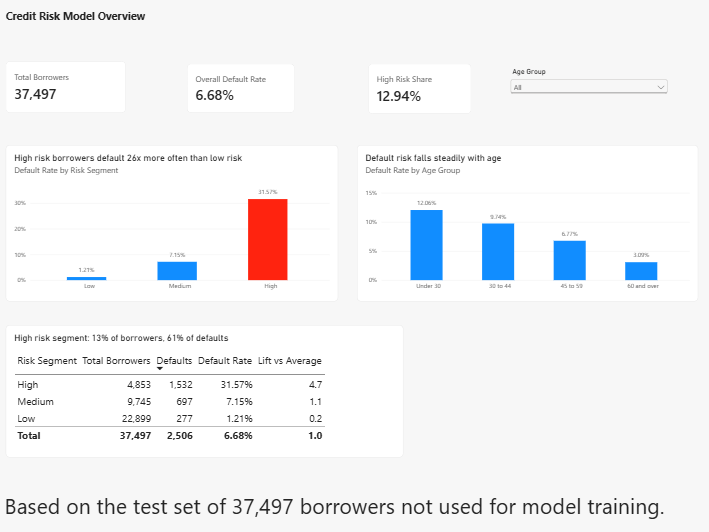
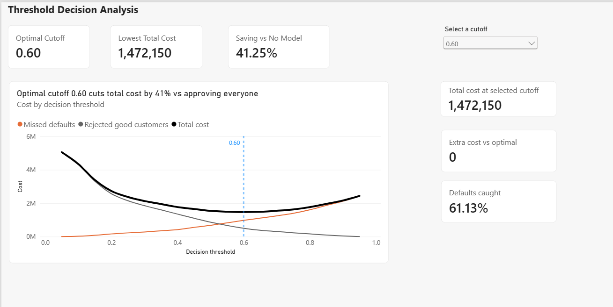

# Credit Risk Prediction & Cost-Sensitive Loan Decision Analysis

A machine learning project that predicts borrower default risk and helps lenders make better loan approval decisions using Python, SQL, and Power BI.

The project goes beyond predicting defaults: it evaluates the financial cost of approving risky borrowers versus rejecting creditworthy customers to identify a more effective lending decision threshold.

## Project Overview

Lending institutions face two major risks:

- **Default risk:** Approving borrowers who fail to repay their loans.
- **Opportunity cost:** Rejecting borrowers who would have successfully repaid their loans.

The objective of this project is to build a machine learning model that identifies high-risk borrowers and determine a decision threshold that minimises the estimated financial cost of lending decisions.

### Key Results

| Metric | Result |
|---|---:|
| Total borrowers | 150,000 |
| Test set size | 37,497 |
| Logistic Regression AUC | 0.82 |
| Random Forest AUC | 0.87 |
| Optimal decision threshold | 0.60 |
| Estimated cost reduction | 41% |
| Defaults captured in high-risk group | 61% |
| Borrowers classified as high risk | 13% |

*Results are based on the project's reported test-set evaluation. Cost estimates use illustrative assumptions rather than actual lender financial data.*

## Dashboard Preview

### 1. Model Overview

This dashboard examines model performance and borrower risk segmentation.

Key observations:
- High-risk borrowers have a default rate of 31.6%.
- Low-risk borrowers have a default rate of 1.2%.
- The high-risk segment contains 61% of all defaults while representing 13% of borrowers.



### 2. Threshold Decision Analysis

This dashboard evaluates how different classification thresholds affect the lender's estimated financial cost.

A lower threshold rejects more borrowers, including creditworthy customers. A higher threshold approves more borrowers, including potential defaulters.

The analysis identifies 0.60 as the threshold with the lowest estimated total cost.



## Technical Implementation

### 1. SQL Data Cleaning

Used SQLite to load and clean the borrower dataset.

Data quality checks included:
- Identifying missing monthly income values.
- Handling invalid late-payment codes such as 96 and 98.
- Removing records with borrower ages outside the 18–100 range.
- Handling missing dependent counts.

### 2. Feature Engineering

Prepared the dataset using Python, pandas, and NumPy.

Created additional features:
- Total number of late payments.
- Indicator for borrowers with a history of 90+ days late payments.
- Income per family member.
- Missing-income indicator.

These features help represent borrower repayment behaviour and financial circumstances.

### 3. Model Development

Developed and compared two classification models:

| Model | AUC |
|---|---:|
| Logistic Regression | 0.82 |
| Random Forest | 0.87 |

Because defaults account for only approximately 7% of borrowers, class weighting was used to address the imbalance between default and non-default cases.

Random Forest was selected as the final model based on its higher reported AUC.

### 4. Cost-Sensitive Threshold Optimisation

Rather than automatically using the standard 0.50 probability threshold, multiple decision thresholds were evaluated.

The project uses the following illustrative cost assumptions:

| Lending decision error | Assumed cost |
|---|---:|
| Approving a borrower who defaults | 1,000 |
| Rejecting a borrower who would repay | 150 |

The estimated total cost was calculated for different thresholds.

The lowest reported cost occurred at a threshold of **0.60**, resulting in a 41% reduction compared with the approve-everyone baseline.

### 5. Power BI Dashboard

Built an interactive dashboard to communicate model performance and lending decisions.

**Dashboard pages:**
- Model Overview
- Threshold Decision Analysis

The dashboard uses predictions from the held-out test set of 37,497 borrowers.

## Technology Stack

| Technology | Purpose |
|---|---|
| Python | Data processing and machine learning |
| Pandas | Data manipulation |
| NumPy | Numerical computations |
| Scikit-learn | Model training and evaluation |
| SQLite | Data storage and SQL cleaning |
| SQL | Data cleaning and transformation |
| Power BI | Interactive dashboards |
| Jupyter Notebook | Development and experimentation |
| Matplotlib / Seaborn | Data visualisation |

## Dataset

The project uses the **Give Me Some Credit** dataset.

- Original source: [Kaggle – Give Me Some Credit](https://www.kaggle.com/competitions/GiveMeSomeCredit/data)
- Approximately 150,000 borrower records.
- Target variable: `SeriousDlqin2yrs`.
- Default is defined as being 90 or more days delinquent within two years.

The dataset is not included in this repository. Download it from Kaggle and place the training CSV in the project directory as:

`credit_risk_training.csv`

## Getting Started

### Prerequisites

- Python 3.10 or later
- Jupyter Notebook
- Git

### 1. Clone the repository

```bash
git clone https://github.com/zertiur/glowing-octo-barnacle.git
cd glowing-octo-barnacle
```

### 2. Create a virtual environment

```bash
python3 -m venv venv
source venv/bin/activate
```

### 3. Install dependencies

```bash
pip install -r requirements.txt
```

### 4. Download the dataset

Download the training dataset from Kaggle and place `credit_risk_training.csv` in the project directory.

### 5. Launch Jupyter Notebook

```bash
jupyter notebook
```

Open `credit_risk_project.ipynb` and execute the notebook cells in order.

## Limitations

- The cost assumptions are illustrative and should be replaced with actual lender-specific costs before real-world use.
- Model performance depends on the dataset and its underlying borrower population.
- Historical patterns may not accurately represent future borrower behaviour.
- The model should not be used as the sole basis for real lending decisions without further validation, fairness assessment, and regulatory review.

## Future Improvements

- Hyperparameter tuning and cross-validation.
- Model explainability using SHAP.
- Additional model comparisons, including XGBoost.
- Fairness and bias evaluation across borrower segments.
- Deployment through a REST API.
- Integration with a real-time credit risk monitoring dashboard.

## Author

**Aditya**

Computer Science Student | Machine Learning | Data Analytics | Software Development

[GitHub Profile](https://github.com/zertiur)

---

*This project was developed for educational and portfolio purposes.*
